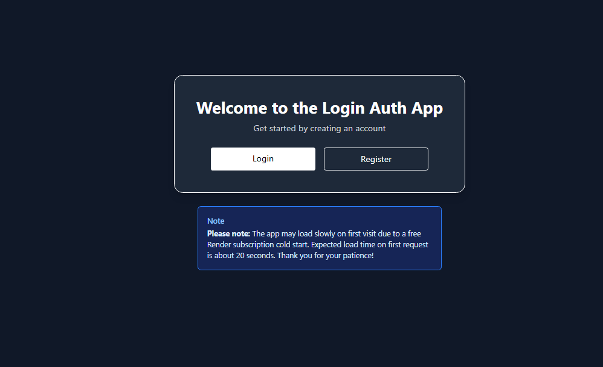
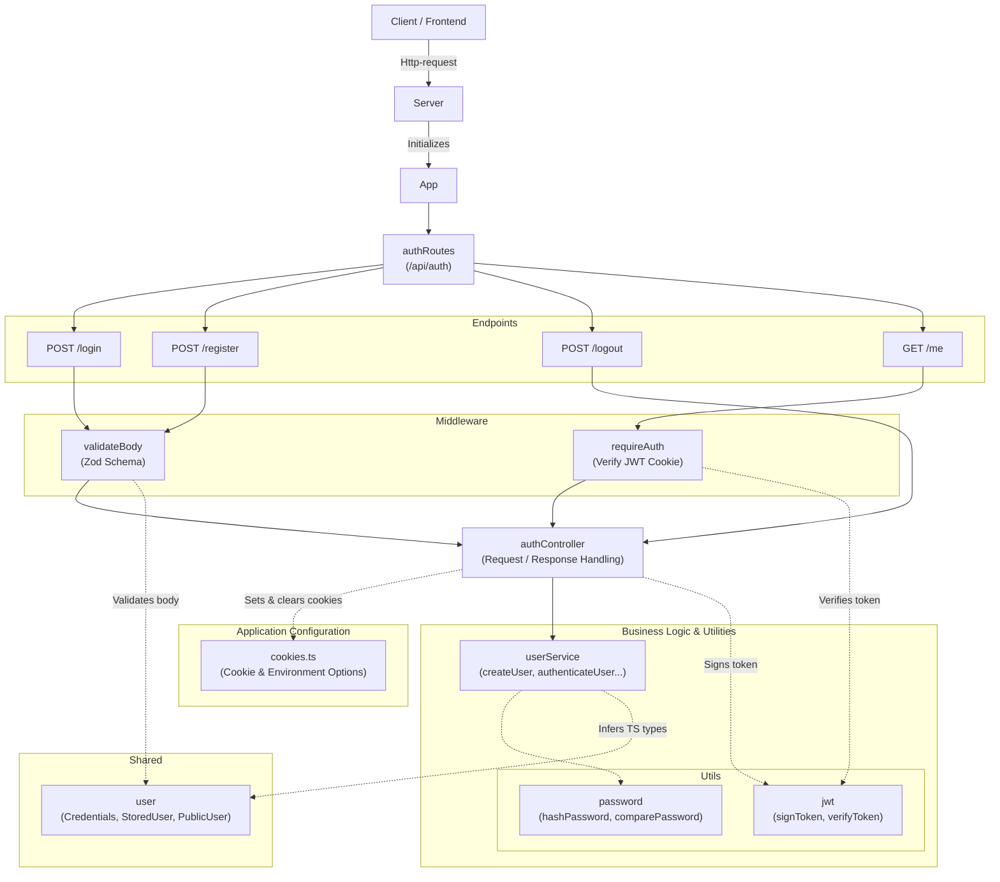

# 🔒 login-token-authentication
> A simple login app, made while practicing jwt token authentication. The app is meant to simulate a user creating an account and login and afterward, then the site displays the users username and id proving that, the token auth was succesful. Featuring a secure backend API & responsive client.

## Tech Stack

- **Frontend:** React 19, React Router 8, TypeScript, Vite, Tailwind CSS, and TanStack Query
- **Backend:** Node.js 22, Express 5, and TypeScript
- **Authentication:** JWT tokens, HTTP cookies, bcrypt password hashing, and Zod validation
- **HTTP and logging:** Axios on the client, CORS on the server, and Pino logging

## Preview (Home + Succesful login)


## Server tests

Run the server test suite from the `server` directory:

```powershell
npm test
npx tsc --noEmit -p test
```

The suite includes API integration tests that start the Express app on an ephemeral
local port and use Node.js 22's built-in `fetch`. They exercise registration, login,
JWT cookie authentication, protected user lookup, logout, validation errors, duplicate
users, invalid credentials, and invalid or expired tokens without requiring Docker,
a database, or an additional HTTP test dependency.

## Backend Component Architecture & Request Pipeline

