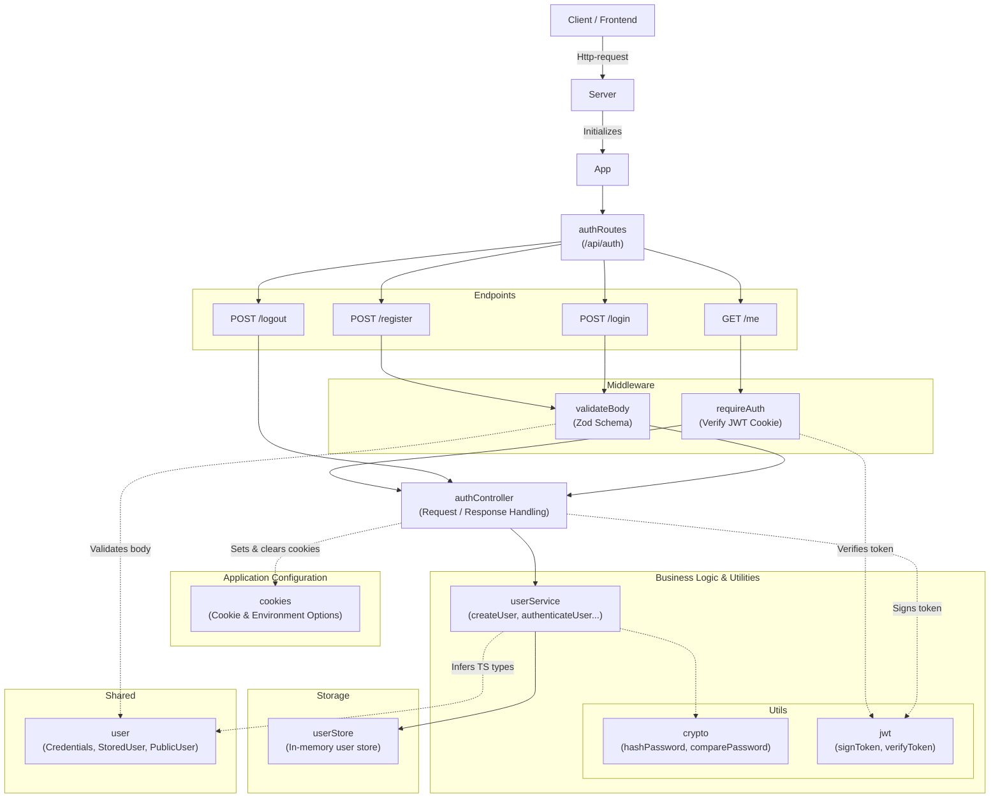

# Backend Component Architecture & Request Pipeline

The backend processes authentication requests through the Express application, routes, validation middleware, controllers, and user service. The user service handles authentication rules and password operations, while the in-memory user store manages stored users for the lifetime of the server process. JWT utilities and cookie configuration support session authentication; restarting the server clears the in-memory users.

